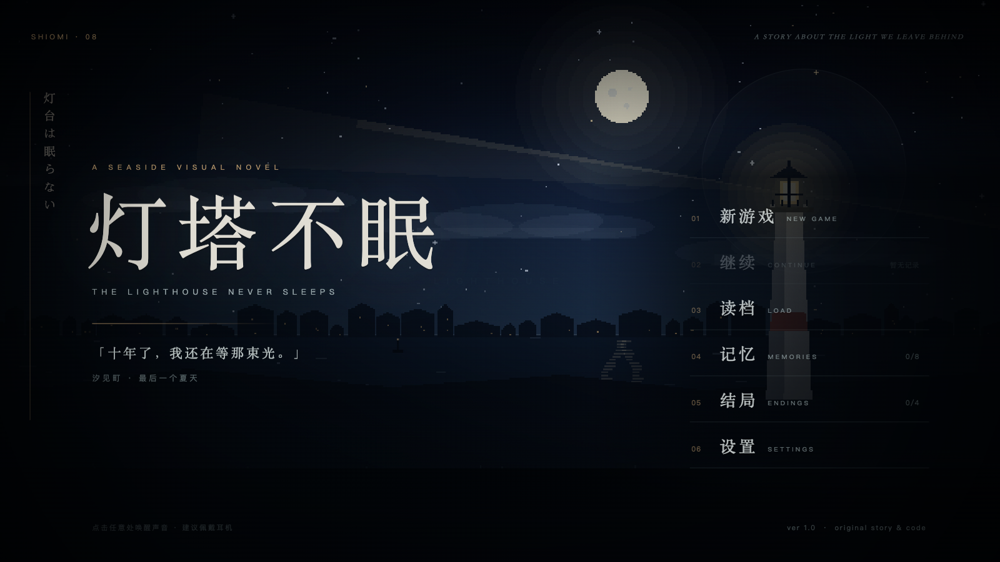
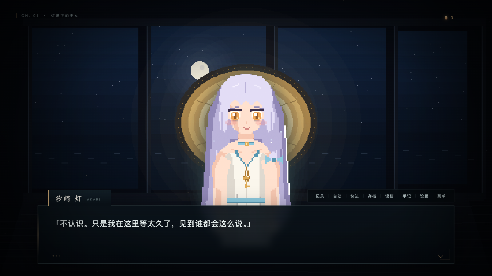
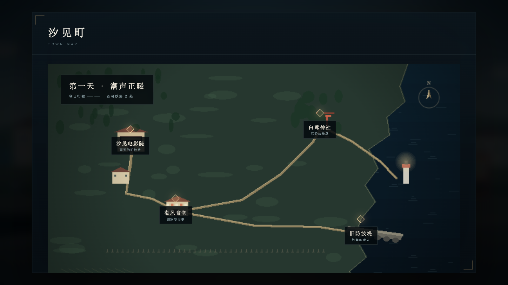
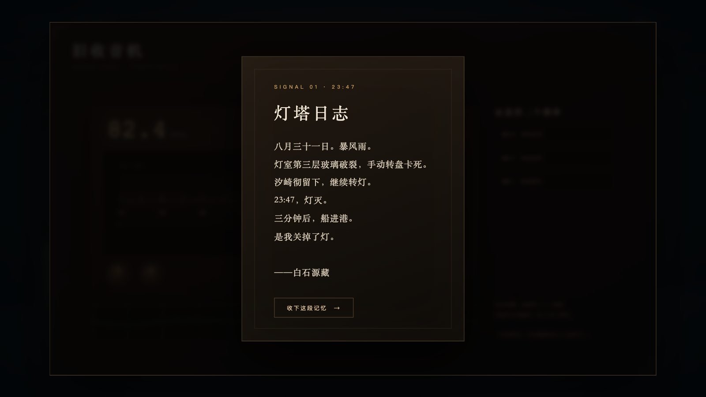

# 灯塔不眠 · The Lighthouse Never Sleeps

> 「十年了，我还在等那束光。」

一部原创的日系海岸视觉小说。发生在八月的最后一周，汐见町，白鹭灯塔。
全部剧情、角色、界面与像素画面均为本作原创；画面不使用任何图片素材，全部由 Canvas 实时绘制。
唯一沿用自参考项目的是 `assets/music/` 中的背景音乐。

- 一周目约 20–35 分钟
- 4 个结局（A / B / C / TRUE）+ 二周目「第二个夏天」
- 8 段记忆碎片、羁绊值、跨周目继承
- 手绘风格小镇地图、旧收音机调频小游戏
- 6 个手动存档 + 自动存档、历史记录、Auto / Skip、设置、记忆与结局画廊
- 桌面与手机浏览器均可游玩（16:9 舞台自动缩放）

---

## 预览









---

## 运行

**推荐：本地服务器**（音乐需要 HTTP 协议）

```bash
cd LastStation-Deepseek
python3 -m http.server 8000
# 浏览器打开 http://localhost:8000
```

也可以直接双击 `index.html`。游戏可以完整游玩，但部分浏览器在 `file://` 下会阻止加载本地 mp3，此时背景音乐静音；音效与环境音仍由 Web Audio 实时合成。

无框架、无构建步骤、无后端、无联网依赖。也可以用任意静态服务器托管。

---

## 操作

| 操作 | 说明 |
| --- | --- |
| 点击对话框 / 空格 / 回车 | 推进对话；文字未显示完时先补全 |
| 按住 Ctrl | 快进（默认只跳过已读文本） |
| 数字键 1–4 | 选择选项 |
| Esc | 关闭面板；游戏中打开菜单 |
| 对话框右上角 | 记录 / 自动 / 快进 / 存档 / 读档 / 手记 / 设置 / 菜单 |
| 地图 | 点击光点前往地点；每个地点每天只能去一次 |
| 收音机 | 拖动刻度或 ← → 调频，Enter / 按钮锁定信号 |

---

## 系统

### 羁绊与记忆

选项和地点事件会改变「灯」的亮度（羁绊）。八段记忆碎片分别藏在旧屋、食堂、神社、防波堤、电影院和旧收音机里。

记忆会**跨周目保留**。二周目里，已经寻回的记忆不会重复出现，但会参与真正的结局判定。

### 结局

<details>
<summary>结局条件（剧透）</summary>

- **A 长夜**：最终选择「让灯塔继续沉睡」。
- **B 归港**：羁绊 ≥ 7，最终选择「点亮灯塔」。
- **C 回航**：完成收音机三段信号、本周目拥有至少 7 段记忆，最终选择「回到十年前」。
- **TRUE 长明**：通关过 C（解锁二周目）、累计集齐八段记忆、本周目羁绊 ≥ 9，最终选择金色的第四条路。

</details>

### 存档

- `自动存档`：进入每个新场景、做出选择、切换背景时更新
- `手动存档`：六个栏位，含实时画面缩略图
- 全局数据（记忆、结局、已读文本、设置）单独保存；清除全部记录会一并删除

---

## 技术实现

纯原生 JavaScript，无依赖。主要模块：

| 文件 | 作用 |
| --- | --- |
| `js/art/pixel.js` | 像素绘制工具：矩形、椭圆、扫描线多边形、抖动、渐变、光晕、云、光束 |
| `js/art/backgrounds.js` | 十余个程序化场景：夜海灯塔、渡轮、小镇、旧屋、灯室、食堂、防波堤、神社、电影院、祭典、风暴、黎明、阁楼等 |
| `js/art/characters.js` | 90×135 逻辑网格手绘角色立绘，10 种表情、眨眼、发丝摆动、幽灵粒子 |
| `js/story.js` | 全部剧情、分支、条件、结局数据 |
| `js/engine.js` | 场景执行器、打字机、选项、Auto / Skip、自动存档、读档、结局 |
| `js/ui.js` | 标题、对话框、角色舞台、章节卡、结局卡、存档 / 设置 / 画廊 / 手记 |
| `js/minigames.js` | 汐见町地图、旧收音机调频（Canvas + Web Audio） |
| `js/audio.js` | BGM 双轨交叉淡入淡出、合成音效、海浪 / 雨声环境音、收音机底噪 |
| `js/save.js` | localStorage 存档、全局进度、已读文本、设置、损坏恢复 |
| `js/state.js` | 当前周目状态、碎片定义、结局定义、效果应用 |

### 一些实现细节

- **打字机**：文本内嵌 `{pause:500}`、`{shake}`、`{em}`、`{c:#hex}` 标记；按字符调度，暂停标签折叠进下一个字符的延迟。
- **像素画面**：背景在 640×360 画布上逐像素绘制，再用 `image-rendering: pixelated` 放大；角色在 90×135 网格上绘制后按 4 倍最近邻放大。
- **存档缩略图**：保存时把当前背景画布压缩成 320×180 JPEG，写入对应存档。
- **音乐**：两个 `<audio>` 循环播放器交叉淡入淡出，切换曲目约 1.4 秒。
- **收音机**：频率刻度 76.0–92.0 MHz，三段目标信号；信号强度同时驱动波形、底噪音量与指示灯。
- **地图**：Canvas 手绘地形 + HTML 定位光点；当天行程用尽后自动进入下一天。
- **响应式**：1280×720 舞台按窗口等比缩放；竖屏手机会显示横屏提示。

---

## 目录

```
.
├── index.html
├── css/
│   ├── base.css          舞台、背景、角色层、章节卡、结局卡
│   ├── title.css         标题画面
│   ├── game.css          对话框、选项、快捷栏
│   └── overlays.css      存档 / 设置 / 记录 / 画廊 / 收音机 / 地图
├── js/                   见上表
└── assets/music/         8 首背景音乐（沿用参考项目素材）
```

---

## 开发与提交

仓库内置了完整的项目协议、静态检查和浏览器 smoke test。

> Agent 任务门禁：每个**新的用户任务**开始前，必须先自动加载并执行 `karpathy-guidelines` skill，再进入修改 → `npm test` → commit 流程。详见 [AGENTS.md](AGENTS.md) 的「规则 0」。


环境要求：Node.js >= 20。`test:e2e` 优先使用本机 Chrome；没有 Chrome 时先执行 `npx playwright install chromium`。

```bash
npm install       # 只安装 Playwright 测试依赖；游戏本身零依赖
npm run setup     # 启用 .githooks/pre-commit（每个 clone 一次）
npm test          # 静态检查 + 真实浏览器 smoke test
npm run serve     # http://127.0.0.1:8000
```

- `npm run test:static`：检查所有 JS 语法、HTML 引用、56 个场景的目标、8 个碎片、4 个结局、地图地点、音频文件与 README 截图。
- `npm run test:e2e`：真实浏览器走标题 → 序章 → 设置 → 存档/读档 → 记录 → 手记 → 地图 → 收音机三段信号 → 移动端布局。

**提交规则写在 [AGENTS.md](AGENTS.md)：每次完成一个连贯变更后必须立刻 commit；commit 前必须 `npm test` 全绿；pre-commit hook 会强制执行，禁止 `--no-verify`。**

CI 工作流在 `.github/workflows/ci.yml`，push / PR 时自动运行同样的测试。

## 素材说明

- **代码 / 剧情 / 角色 / 界面 / 全部画面**：本作原创。没有复制参考项目的代码或剧情文本。
- **背景音乐**：来自参考项目 `laststation-summer` 的 `assets/music/`，按你的授权直接沿用。曲目包括 `title_theme`、`town_day`、`mio_theme`、`mystery_theme`、`festival_theme`、`farewell_theme`、`true_end_theme` 以及 SLSMusic 的钢琴曲《如果可以》。
- **音效与环境音**：浏览器 Web Audio API 实时合成，无外部素材。
- 若要将本作公开发布，请先确认上述音乐的使用授权。

---

## 浏览器

Chrome / Edge / Safari / Firefox 近两年版本。需要 Canvas 2D、Web Audio、localStorage。
iOS Safari 建议横屏并佩戴耳机；首次点击画面后才会启动声音（浏览器自动播放限制）。

---

## 测试记录

开发时使用 Playwright + Chrome 完成：

- 从标题到 Ending B 的全流程自动通关（342 个剧情步，包含地图、调频、全部 10 次选择）
- A / B / C / TRUE 四条结局分支与 NG+ 解锁
- 存档 → 刷新 → 继续读档（含缩略图、场景、行号、羁绊、碎片、角色）
- 地图每日 2 次行程与去向回环
- 收音机三段信号、记忆卡、完成后剧情衔接
- 设置面板、记录、手记、记忆与结局画廊
- `file://` 直接打开（无音乐）与 HTTP 服务器（含音乐）
